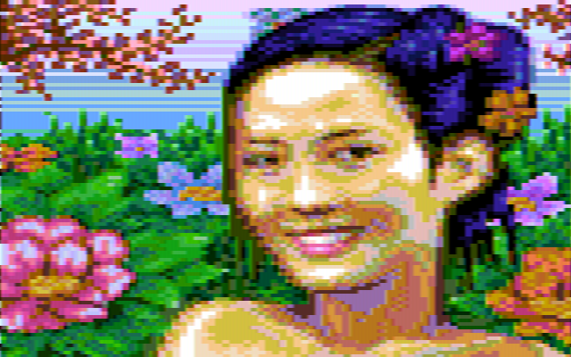
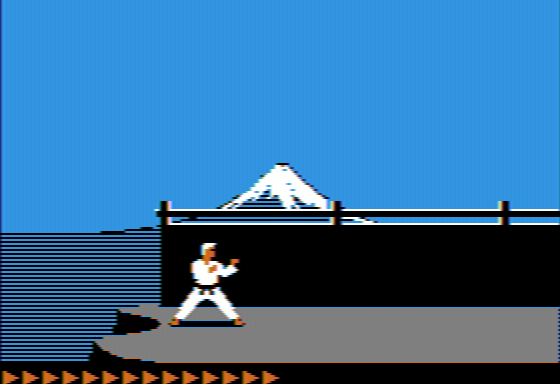
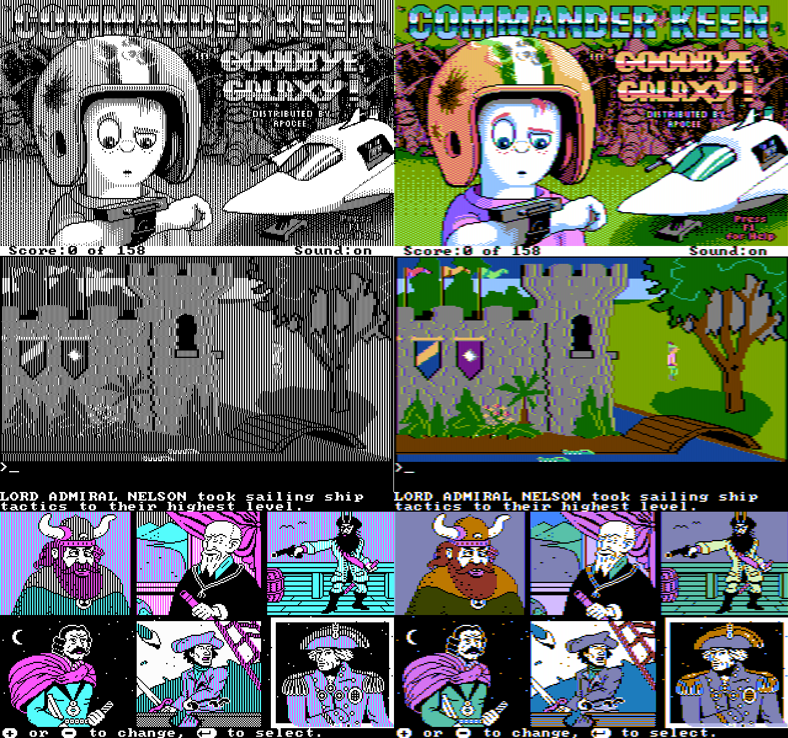
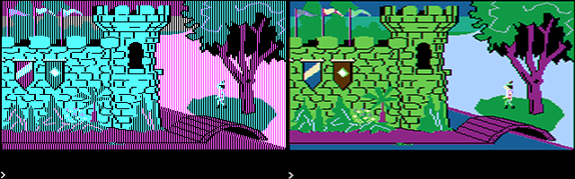
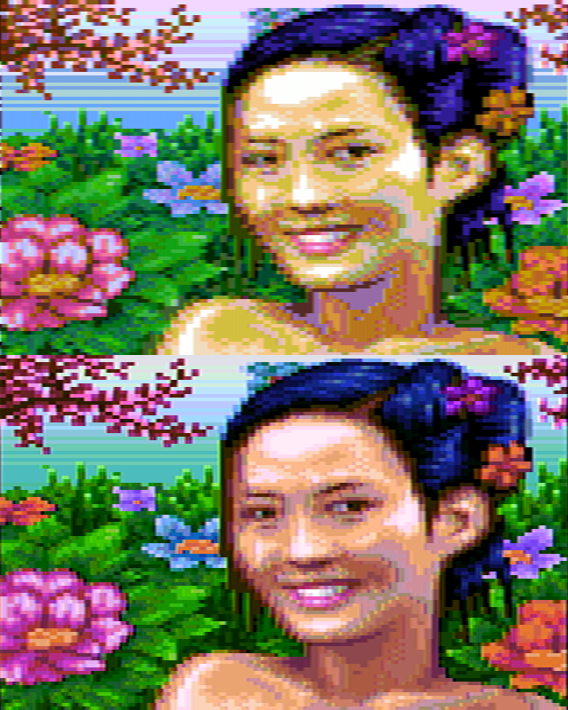

# Composite Artifact Color Decoder

Artwork by [VileR](https://int10h.org)

## Summary

Decodes NTSC composite artifact color from RGBI image data. This is not intended to be a full NTSC simulation.

CGA images are encoded into the output of the color generation circuit of the CGA based on the original schematic published in the IBM Personal Computer AT Technical Reference, First Edition (1984). That quasi-composite output is then sampled for luma and chroma signals.

Developed for my PC emulator, MartyPC: https://github.com/dbalsom/martypc

## Apple II 

This utility was primarily designed to decode composite artifact color produce by the IBM CGA, but it turns out it works acceptably well for other systems like the Apple II. 

Apple II titles running in high-res mode require an initial 90 degree phase offset, use the `--phase-deg=90` option.

## Composite Conversion

Programs that have a Composite output mode utilizing the CGA's high resolution monochrome mode with a foreground color of bright white have an RGBI image essentially congruent to their composite signal - they can be sampled for artifact color direcctly. This is because the CGA color clock generator for White is tied to +5V, so whenever a white pixel appears on the screen, a composite signal of full luminance is output.  However, the story is different when color is involved, such as if the foreground color in high resolution mode is changed, or when games use a 320x200 4 color mode (See screenshot below), or text mode effects intended for composite displays such as the famous PC demo, 8088mph.  Naive sampling of the RGBI image data directly for artifact color will not produce the correct result.

## A note on Sierra screenshots

Screenshots of early Sierra titles showing the CGA's magenta and cyan palette (RGBI mode) are not correct for a composite display, so will produce erroneous colors. The video mode these games operated in for composite output was the CGA's monochrome 640x200 high resolution mode. 

# Reenigne's multiplexer

As of July 1, 2023 I've included a third method, 'Reenigne', which implements [reenigne's](https://www.reenigne.org/blog/improved-composite-mode-support-for-dosbox/) chroma multiplexer algorithm in Rust. This produces superior results as it better models the analog behavior of the chroma multiplexer. This algorithm is also much faster, although much more difficult to comprehend.

You can see my results vs reenigne's:

## Credits and Thanks
Thank you to reenigne, xot and EMMIR

## Usage

Decode 'war.png' to 'output.png' with specified hue, saturation and luminosity, using fast method

cga_artifact --input .\examples\war.png -h 1.5 -s 1.5 -l 1.0 --method fast 

Decode 'king.png' to 'output.png' with specified hue, saturation and luminosity, using accurate method

cga_artifact --input .\examples\king.png -h 1.5 -s 1.5 -l 1.0 --method accurate 
